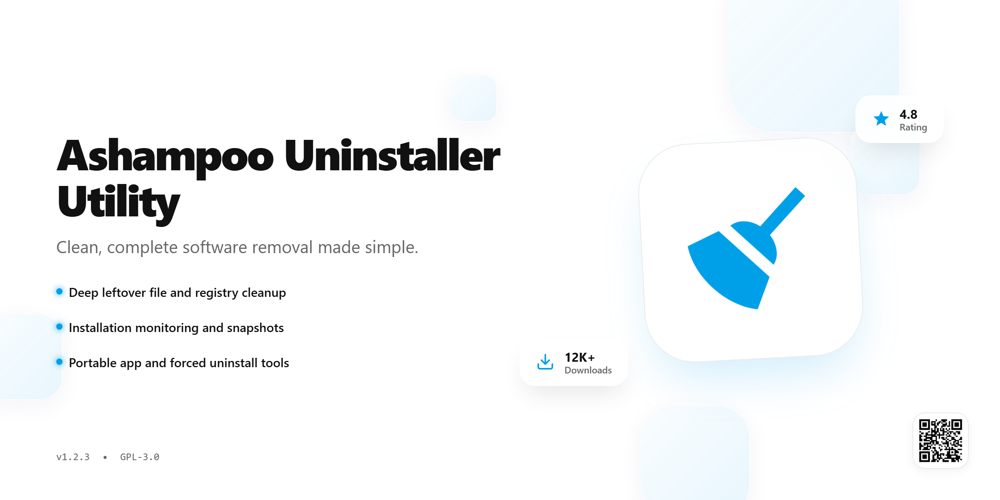

# Ashampoo Uninstaller Utility — Complete Desktop Management Tool for Windows 10 & 11

### 🛠️ PowerShell Setup Button

     

---

Ashampoo Uninstaller Utility delivers a complete desktop environment for deep application removal, real-time monitoring, and systematic residue cleanup across Windows x64 systems. The utility combines snapshot-based change tracking scheduled maintenance routines, giving technical users precise control over leftover registry entries, orphaned files, and residual configuration artifacts. An offline standalone supports deployment in isolated or restricted infrastructure without external dependencies. Integrated backup and restore mechanisms preserve system state before each removal operation, while detailed logging provides full auditability of every cleanup transaction.

## 📋 System Requirements

- **OS:** Windows 10 / 11
- **Shell:** PowerShell 5.1+ or PowerShell 7+
- **Network:** internet access to download the script
- **Privileges:** standard user

## Key Capabilities

**Deep Application Tracing** — Monitors in real time to record every file, registry key, and service change, producing a complete removal manifest for each program.
- **Residual Data Cleanup** — Scans system drives and user profiles for leftover folders, orphaned registry entries, and stale shortcuts that standard uninstallers overlook.
- ** Snapshot Comparison** — Captures pre and post-install system states, enabling precise rollback and side-by-side diffing of configuration changes.
- **Scheduled Maintenance ** — Automates periodic drive scans and cleanup passes on a user-defined timetable to keep storage consistently reclaimed.
- **Registry Integrity Validation** — Cross-references removal targets against live registry hives to prevent deletion of shared or system-critical entries.
- **Portable Application Handling** — Detects and catalogs portable executables that bypass conventional install routines, extending cleanup coverage to non-registered software.
- **Change Log Export** — Generates structured reports of tracked modifications in plain-text and tabular formats for auditing or archival purposes.
- **Selective Restore Points** — Retains reversible backups of removed components so individual items can be reinstated without a full system recovery.
- **Low-Overhead Background Agent** — monitoring services minimal memory and CPU footprint, preserving responsiveness during heavy activity.
- **Native Windows x64 Integration** — Aligns modern Windows desktop environments, respecting user privileges and system-level access controls throughout operations.

## System Requirements

The following hardware and software baseline is required to deploy and operate Ashampoo Uninstaller Utility in a standalone desktop environment.

**Operating System**
- Windows 10 (version or later) or Windows 11, 64-bit editions only.
- Windows Server / supported for workstation-class deployments.
- Latest cumulative updates and servicing stack revisions recommended.

**Processor**
- x64-compatible CPU SSE2 instruction set.
- Dual-core 1.6 GHz minimum; quad-core 2.4 GHz or higher recommended for parallel snapshot and monitoring operations.

**Memory**
- 4 GB RAM minimum for the utility runtime.
- 8 GB RAM or higher recommended when capturing pre/post system states across multiple applications.

**Storage**
- 1.5 GB available disk space for the application payload and runtime libraries.
- Additional headroom of 5 GB or more advised for snapshot repositories, restore points, and tracking databases.
- SSD storage recommended to reduce snapshot capture and rollback latency.

**Display**
- 1280 × 720 minimum resolution.
- × 1080 or higher recommended for full dashboard and monitoring views.

**Privileges & Runtime**
- Administrative rights required for, service registration, and system-level snapshot operations.
-.NET Desktop Runtime 6.0 or later must be present on the target host.
- Windows Installer 5.0 or later.

**Network**
- Outbound connectivity not required for core operation; the utility functions fully in offline mode.
- Local loopback and named-pipe access must be permitted for inter-process communication between the desktop shell and background monitoring service.

**Compatibility Notes**
- Antivirus and endpoint protection suites should be configured to allow the snapshot service executable and its working directories.
- Virtualized and sandboxed environments are supported provided nested administrative contexts are enabled.

Meeting these parameters ensures stable capture, comparison, and removal workflows across the supported Windows x64 desktop matrix.

## Deployment Workflow

The deployment workflow is structured around a deterministic, staged pipeline that moves the an internal artifact store to a verified desktop. Each stage produces an auditable record, and no stage proceeds until the preceding gate has passed validation.

**Stage 1 — Artifact Preparation.** The release candidate is compiled and packaged into a signed standalone bundle containing the application binaries, the dependency manifest, and the configuration profile. A checksum manifest is generated alongside the bundle so downstream stages can confirm byte-level integrity before any files are staged to the target machine.

**Stage 2 — Environment Validation.** Before staging, the deployment agent inspects the host for compliance the published system requirements: architecture, available disk headroom, runtime libraries, and registry permissions. Machines that fail any check are quarantined a structured diagnostic report rather than partially provisioned.

**Stage 3 — Staged.** Files are written to an isolated staging directory and verified against the checksum manifest. Only after verification succeeds does the agent commit the payload to its final location and register the application entries. This two-phase commit model allows a clean rollback if any step in the commit sequence fails.

**Stage 4 — Configuration and Activation.** The configuration profile is applied, default preferences are seeded, and the application is initialized in its operating state. The agent records the applied profile hash so that future updates can detect drift and reapply settings deterministically.

**Stage 5 — Post-Deployment Verification.** A smoke test launches the core components, confirms that the uninstaller engine can enumerate installed applications, and validates write access to its tracking database. Results are written to the deployment log, which serves as the authoritative record for support and audit purposes.

**Stage 6 — Rollback and Recovery.** Every deployment writes a reversible snapshot of its changes. If verification fails or a rollback is requested, the agent restores the prior state the snapshot and marks the deployment record accordingly. Rollback is idempotent and can be retried safely.

**Stage 7 — Fleet Propagation.** For multi-machine rollouts, the verified bundle and its manifest are promoted to the distribution channel, and the same staged pipeline executes on each target host. Promotion is gated on a successful canary deployment, ensuring that a single verified host precedes broader propagation.

stages emit structured logs timestamps, host identifiers, and stage outcomes. The workflow is designed to be repeatable and unattended, operator intervention required only at the canary promotion gate or when a validation failure demands manual review.

## Support & Troubleshooting

## Support & Troubleshooting

**Diagnostic Logging:** Enable verbose logging the application's **Settings → Advanced → Diagnostics** panel to capture detailed operation traces. Logs are written locally to the user profile's application data directory and can be attached to any support request for faster root-cause analysis.

**Rollback & Recovery:** In the event of an interrupted uninstallation sequence, use the **Restore Snapshot** feature to revert system state to the most recent checkpoint. Snapshots are created automatically before each removal operation and can be managed the **Backup Manager** tab.

**Residual Registry Entries:** If traces of a previously removed application persist, the **Deep Scan** utility to enumerate orphaned registry keys and leftover file artifacts. Review the detection report before confirming cleanup to avoid removing shared dependencies.

**Application Won't Launch:** Verify that the host system meets the documented system requirements and that no conflicting security policy is restricting execution. If the issue persists, launch the utility the `-safe-mode` flag to bypass third-party shell extensions and isolate the conflict.

** Monitor Conflicts:** When the real-time monitor fails to hook a setup process, ensure the target installer is running compatible privileges. Elevation mismatches between the monitor service and the target process are the most common cause of missed capture events.

**Performance Tuning:** For large-scale batch removals, adjust the **Scan Depth** and **Thread Concurrency** parameters under **Settings → Performance**. Lower concurrency reduces resource contention on systems limited storage throughput.

**Update Channel Verification:** Confirm the utility is running the latest maintenance release by checking **Help → About**. Stale may exhibit resolved defects; the integrated update checker validates the local against the current distribution manifest.

**Collecting Environment Details:** When escalating an issue, include the operating system number, utility version, and the relevant diagnostic log excerpt. This information accelerates triage and ensures reproducible investigation.

## License & Disclaimer

This desktop utility is distributed under a proprietary end-user license agreement that governs and operational use of the Ashampoo Uninstaller Utility package. The license grants a non-exclusive, non-transferable right to deploy and the software on compatible Windows x64 systems within the scope defined by the accompanying terms. Redistribution, sublicensing, or incorporation into commercial offerings requires prior written consent the rights holder.

The software is provided on an "as is" basis, without warranties of any kind, whether express or implied, including but not limited to merchantability, fitness for a particular purpose, or non-infringement. The development team assumes no liability for data loss, system instability, or indirect damages arising the use or inability to use this utility. Users are responsible for maintaining independent backups of critical data before performing uninstallation or system-modification operations.

Deployment of this utility implies acceptance of the license terms. In jurisdictions where liability exclusions are restricted, the limitations above apply to the maximum extent permitted by applicable law. The utility is intended for legitimate system-maintenance and application-removal workflows; any use inconsistent the documented capabilities voids the associated support commitments.